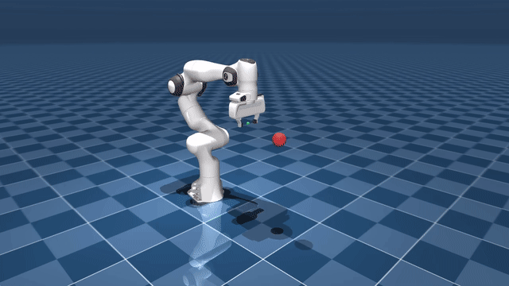
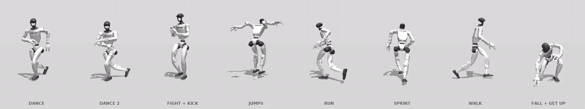
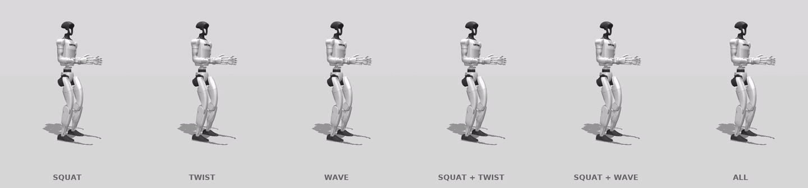
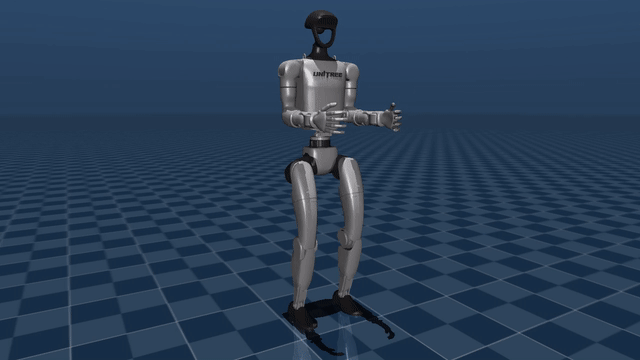

# rigidax

Differentiable rigid-body kinematics and dynamics in JAX. Its design starts from
[frax](https://github.com/StanfordASL/frax): the dense, loop-free formulation of the
dynamics over a DOF ancestor mask. It fills in frax's gaps:

| | frax 0.2 | rigidax |
|---|---|---|
| Model formats | URDF | **MJCF and URDF** (compiled by MuJoCo) |
| Joint types | revolute, prismatic, free | hinge, slide, **ball**, free, **several joints per body** |
| Gravity | hardcoded 9.81 in `forward_dynamics` | **model parameter**, any vector |
| Physical parameters | frozen into the compiled function | **pytree leaves**: `jax.grad` / `vmap` over masses, inertias, offsets, gravity; swap them without recompiling |
| Armature | no | yes (in M and inverse dynamics) |
| External wrenches | per-link | per-body, MuJoCo `xfrc_applied` layout |
| Ground truth tests | Pinocchio / MuJoCo | every quantity vs MuJoCo on random trees + G1/A2/Panda, plus Pinocchio |



The Panda tracks a figure-eight with operational space control (`examples/osc_demo.py`).
rigidax computes the kinematics, Jacobian, mass matrix and bias forces in about 54 µs
per step, Python dispatch included. Mean tracking error is 0.9 mm. MuJoCo only
simulates and renders.

```
env -u PYTHONPATH MUJOCO_GL=egl python examples/osc_demo.py --out osc_demo.mp4
```



Two output variants are produced from the same solve settings. Speed on the same
laptop with self-collision: 22.8k frames/s for the plain G1 and 18.8k for G1 + Dex3. The
Dex3 version is slower because the finger envelope adds collision spheres. frax, with
self-collision, runs at 18.3k.

| Variant | Command | Output | GIF |
|---|---|---|---|
| G1 + Dex3 hands (default) | `retarget_lafan1.py <clips>` | `data/g1_lafan1_hands/` (nq 50) | `examples/g1_lafan1.gif` |
| Plain G1, rigid hands | `retarget_lafan1.py <clips> --no-hands` | `data/g1_lafan1_nohands/` (nq 36) | `examples/g1_lafan1_nohands.gif` |

Both variants track the forearm twist. Palm floor contact and fingers are Dex3-only.
Render a variant with `render_motions.py --data data/g1_lafan1_nohands ...`.

## `rigidax.ik`: batched IK and retargeting

A dedicated differential IK solver for retargeting whole datasets on CPU:

- **Each Gauss-Newton step is a small QP**, solved by a purpose-built fixed-iteration
  ADMM (`rigidax.ik.solve_qp`). It has no branches, so it vectorizes over thousands of
  frames. It uses:
  - row equilibration,
  - one explicit inverse per solve, then matrix-vector products (batched triangular
    solves are slow on XLA:CPU),
  - warm starts from the previous frame,
  - optional polishing.
- **Constraints:**
  - hard joint limits,
  - a per-iteration trust region, so a joint can never flip across its range in one
    frame,
  - a hard floor (`FloorPoints`),
  - elastic self-collision, an exact L1 penalty that keeps the problem always feasible,
    on an automatic sphere model of any MuJoCo model (`SphereModel.fit`).
- **Tasks:** position, orientation, limb direction (retargets between skeletons with
  different proportions) and posture.
- **Batching:** `solve_trajectory` splits clips into segments that run in parallel (vmap
  within a device, pmap across devices). Each segment is seeded by a multi-start solve,
  and consecutive segments are crossfaded so seams are smooth.

```python
from rigidax import ik
tasks = [ik.position(model, bodies, w), ik.direction(model, links, bases, w),
         ik.orientation(model, frames, w), ik.PostureTask(posture_w)]
solver = ik.IKSolver(model, tasks, floor=ik.FloorPoints.on(model, feet, sole_points),
                     collision=ik.SphereModel.fit(mj_model, model, pair_filter=...))
qs, costs = solver.solve_trajectory(seed_fn, [clip1_targets, clip2_targets, ...])
```

### vs frax on LAFAN1 → Unitree G1

Both libraries ran frax's own LAFAN1 settings on the same i9-11900H laptop (8 cores, one
XLA device per core), on 8 clips (53,621 frames, 30 min of motion). Both outputs are scored
with the same metrics:
- **Motion kept:** robot vs human limb angular speed (1.0 = all of it).
- **Lag:** in frames.
- **Joint acceleration:** worst 5% of frames.
- **Skating:** the robot's toe contact sliding while the human toe is planted.
- **Penetration:** MuJoCo's own mesh collision check.

`bench/bench_frax_ik.py` runs frax.

| | frames/s | arm / leg dir. error p95 | hand / forearm rot. p95 | arms / legs kept | lag (frames) | >20° jumps | skate median / p95 | touchdown p95 | penetration | through floor |
|---|---|---|---|---|---|---|---|---|---|---|
| frax, self-collision | 18,327 | 17.4° / 11.6° | 13° / 20° | 0.88 / 0.95 | 0.16 | 1.9% | 4.6 / 32 cm/s | 40 | 0.0% | 0.6 cm max |
| **rigidax, self-collision** (plain G1) | **22,836** | **14.0°** / 11.7° | **12°** / 24° | **0.92** / 0.94 | **-0.01** | **0.1%** | **0.9 / 21** | **35** | 0.0% | 3.8 cm max (lying) |
| frax, no self-collision | 37,490 | 17.1° / 11.3° | 11° / 19° | 0.88 / 0.95 | 0.15 | 1.8% | 4.4 / 31 | 38 | 3.3% | |
| **rigidax, no self-collision** | **46,808** | **3.9°** / 11.7° | 10° / 22° | **0.96** / 0.94 | -0.10 | **0.1%** | **0.9 / 21** | **35** | 2.2% | |

The rigidax task set covers everything frax tracks: pelvis, the thigh / shin / foot links,
torso, and the upper arm / forearm / hand orientations. It adds limb directions and
toe contact points on top.

Where frax is still slightly ahead:
- forearm twist (24° vs 20°),
- leg motion kept (0.94 vs 0.95).

frax's lower joint-acceleration number (8.4 vs 9.3°/f²) is mostly smoothed-away motion.
On the knees, rigidax matches the human's own knee acceleration and frax sits below it.

Hands: the output uses the G1 with Dex3-1 hands (`g1_with_hands.xml`, 7 finger joints
per hand). The body is solved on the 35-DOF model and the finger angles are written
afterwards, since nothing depends on them, which keeps the solve as fast as before.
- **Synthesized fingers:** LAFAN1 records no fingers, so the grip is inferred from context
  and is not tracked motion:
  - fist in a fighting guard (hand in front of the chest, in the chest frame) or during
    a strike, in `fight` clips only;
  - flat open hand while the human hand rests on the floor;
  - relaxed otherwise.
- **Palm contact:** a height task puts the palm on the floor while the human hand rests
  there. The previous hover was 6.2 cm; now it is about 0.
- **Forearm twist:** a twist-only task about the forearm axis.

Diagnostics:
- `examples/render_overlay.py`: draws the solver's targets over the robot (visible red
  means a real tracking error).
- `examples/floor_report.py`: whole-body floor penetration.
- `examples/collision_report.py`: self-collision.

```
# CPU, one XLA device per core
XLA_FLAGS="--xla_force_host_platform_device_count=8 --xla_cpu_multi_thread_eigen=false" \
  python examples/retarget_lafan1.py dance1_subject1 walk1_subject1 ...   [--no-collision]
python examples/collision_report.py dance1_subject1 ...   # MuJoCo mesh ground truth
```

LAFAN1 is CC BY-NC-ND 4.0 (non-commercial). Get it with:

```
curl -L -o data/lafan1.zip https://github.com/ubisoft/ubisoft-laforge-animation-dataset/raw/master/lafan1/lafan1.zip
unzip -j data/lafan1.zip '*.bvh' -d data/lafan1
MUJOCO_GL=egl python examples/render_motions.py --out g1_lafan1.gif dance1_subject1:DANCE \
  dance2_subject3:"DANCE 2" fightAndSports1_subject1@13.8:"FIGHT + KICK" jumps1_subject1:JUMPS \
  run1_subject2:RUN sprint1_subject2@177:SPRINT walk1_subject1:WALK fallAndGetUp1_subject1@63:"FALL + GET UP"
# clip@seconds picks the window; without it the most active 10 s are used
```





A free-floating Unitree G1 (35 DOF) squats, twists and waves while balancing on its
feet (`examples/g1_demo.py`). Per step, rigidax computes:
- M and h, the foot contact Jacobians, and Jc_dot·v (via autodiff)
- reference accelerations that keep the feet planted (KKT solve)
- the contact wrenches that balance the floating base
- the feedforward joint torques

Joint PD supplies the feedback. A step takes about 190 µs. MuJoCo's position servos
are replaced by pure torque motors.

```
env -u PYTHONPATH MUJOCO_GL=egl python examples/g1_demo.py --out g1_demo.mp4
# one motion set, frax-style grey studio: --motion squat|twist|wave|squat,wave|all --style light
```

## Use

```python
import jax, rigidax as rx
jax.config.update("jax_enable_x64", True)

model = rx.load("robot.xml")              # or .urdf; strip_meshes=True if meshes are missing
q, v = model.q0, jax.numpy.zeros(model.nv)

M, bias = jax.jit(rx.dynamics_terms)(model, q, v)            # one kinematics pass
qacc = jax.jit(rx.forward_dynamics)(model, q, v, tau)
moon = model.replace(gravity=jax.numpy.array([0, 0, -1.62]))  # no recompile

# gradients w.r.t. physical parameters (e.g. system identification)
dL_dmass = jax.grad(lambda m: loss(model.replace(body_mass=m)))(model.params.body_mass)
```

Available functions: `forward_kinematics`, `site_pose`, `body_pose`, `point_jacobian`,
`site_jacobian`, `body_jacobian`, `center_of_mass`, `center_of_mass_jacobian`, `rnea`,
`mass_matrix`, `bias_forces`, `gravity_forces`, `coriolis_forces`, `dynamics_terms`,
`forward_dynamics`, `mass_matrix_inverse`, `integrate`, `difference`.
Every function takes an optional `kin=` argument to reuse a forward-kinematics pass.

Conventions follow MuJoCo: `q` uses `[pos, wxyz quat]` for free joints and `wxyz` for
ball joints. `v` uses world-frame linear and body-frame angular velocity.

## Tests

```
env -u PYTHONPATH python -m pytest      # unset ROS's PYTHONPATH if it is sourced
```

## Speed vs frax (CPU, float64, single thread, jax 0.4.30)

Median µs per call, from `bench/bench_vs_frax.py`, two runs. A ratio above 1 means rigidax is faster.

| | Panda single | G1 (35 dof) single | Panda batch 1024 | G1 batch 1024 |
|---|---|---|---|---|
| mass matrix | 0.96–0.98x | 0.97x | 1.09x | 1.02–1.15x |
| bias forces | 0.85–0.91x | 0.78–0.80x | 0.95–1.02x | 0.91–0.92x |
| forward dynamics | 0.82–0.87x | 0.95–0.96x | 0.97–1.11x | 0.94–0.97x |

The two are about equal overall. The single-call bias computation is still 10–20% slower.
GPU has not been benchmarked.

## Known limitations (1.0)

- **Synthesized fingers:** Dex3 finger motion is inferred from context (LAFAN1 has no
  finger data). Finger collisions are handled with rigid envelopes, so fists held
  against the torso in the fight guard still touch it in about 1% of frames.
- **GPU:** the GPU path works but is not tuned (~6k frames/s on an RTX 3060 laptop).
- **G1 forearm pronation:** on the G1 this lives on `wrist_roll_link`. The twist task
  currently targets `elbow_link`.

## Roadmap

- Foot skating p95 (contact-aware per-frame weights), GPU throughput
- Capsule/box collision primitives
- Close the remaining bias-forces gap; GPU benchmarks
- Analytic derivatives of RNEA and ABA
